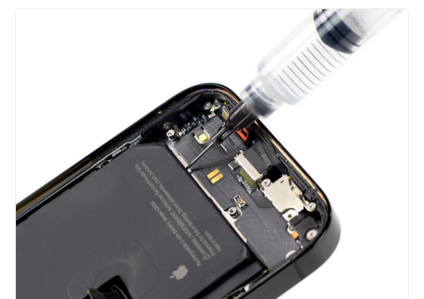

# DFD Study Log 01: iPhone 14 Pro Battery Replacement (Virtual Teardown)

## 1. Target Device Overview
* **Device Name:** iPhone 14 Pro
* **Disassembly Goal:** Battery Replacement
* **Analysis Type:** Virtual Teardown Analysis
* **iFixit Guide:** iPhone 14 Pro Battery Replacement

---

 ## 2. Visual Teardown Reference

*Figure 1: Applying isopropyl alcohol solvent to dissolve strong battery adhesive strips during disassembly. (Source: iFixit)*

---

## 3. DFD Audit Checklist

### 1. Fasteners & Hardware
* [ ] **Minimum Variety:** Fail — Uses multiple distinct screw types (Pentalobe, Tri-point Y000, Phillips).
* [ ] **Standard Drives:** Fail — Relies on proprietary Pentalobe screws at the exterior and Tri-point screws internally.
* [ ] **Fastener Elimination:** Fail — Relies on heavy perimeter adhesive rather than mechanical snap-fits.

### 2. Bonding & Materials
* [ ] **Zero Permanent Glue:** Fail — Strong perimeter adhesive seals the display to the frame.
* [ ] **Thermal / Mechanical Release:** Partial Pass — Uses stretch-release adhesive pull-tabs under the battery, but they frequently snap during removal.
* [ ] **Material Separation:** Pass — Battery, glass, and chassis can be separated once freed from adhesives.

### 3. High-Wear Component Access
* [ ] **First-Layer Access:** Partial Pass — Display comes off first, but requires heat and prying tools before accessing battery connectors.
* [ ] **Tool-Free Removal:** Fail — Requires suction cups, picks, heat guns, and multiple specialized screwdrivers.

### 4. Modular Architecture
* [ ] **Sub-Assemblies:** Pass — Battery, display, and camera modules are independent units.
* [ ] **Cable Management:** Pass — Uses press-fit ZIF connectors on the motherboard.

---

## 4. Manufacturer Intent & Business Context
* **Why Apple Designed It This Way:** 
  1. **IP68 Water & Dust Resistance:** Glue creates a tight, gapless seal around the edges that rubber gaskets alone struggle to maintain at a thin profile.
  2. **Ultra-Slim Aesthetics:** Adhesives take up far less internal volume than mechanical clips, screws, or mounting bosses.
  3. **Control over Servicing & Upgrades:** Proprietary screws (Pentalobe/Tri-point) deter third-party repairs and encourage customers to buy new devices when battery health degrades (Planned Obsolescence).

---

## 5. Engineering Critique & DFD Redesign

* **Main Design Flaw:** Heavy reliance on heat-softened perimeter glue and multi-drive screws slows down manual servicing, risks battery punctures, and complicates automated industrial recycling.
* **DFD Redesign Recommendation:** Replace perimeter glue with a reusable mechanical rubber gasket paired with snap-fit latches, standardize all internal hardware to Phillips #00 screws, and use push-to-release mechanical battery latches instead of stretch-adhesive pull-tabs.
