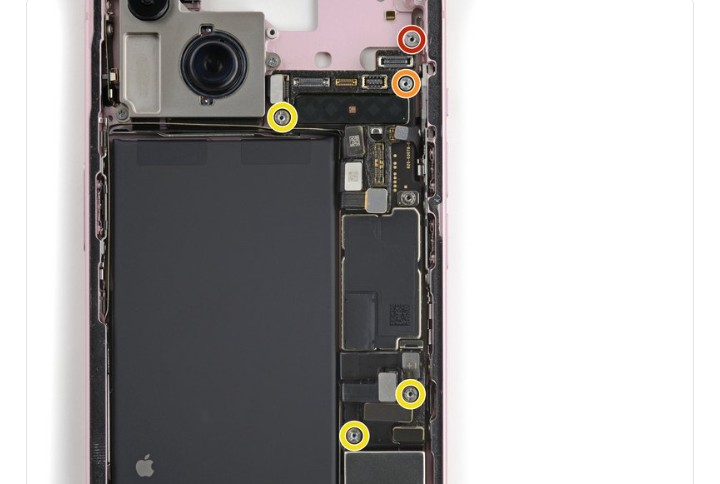

# DFD Study Log 02: iPhone 15 Logic Board Replacement (Virtual Teardown)

## 1. Target Device Overview
* **Device Name:** iPhone 15 (Base Model)
* **Repairability Score:** 7/10 | **DFD Grade:** B- (Dual-Entry Glass Architecture)
* **Disassembly Goal:** Logic Board (Motherboard) Replacement
* **Analysis Type:** Virtual Teardown Analysis
* **iFixit Guide:** iPhone 15 Logic Board Replacement

---

## 2. Visual Teardown Reference

*Figure 1: Internal chassis view displaying the five standoff screws securing the iPhone 15 logic board. (Source: iFixit)*

---

## 3. DFD Audit Checklist

### 1. Fasteners & Hardware
* [ ] **Minimum Variety:** Fail — Uses a mix of Standoff screws, Tri-point Y000, Pentalobe, and Phillips screws securing the logic board and grounding covers.
* [ ] **Standard Drives:** Fail — Requires multiple specialized screwdrivers (Standoff driver, Tri-point, Pentalobe) just to free the motherboard.
* [ ] **Fastener Elimination:** Partial Pass — Uses press-fit brackets over screws in some shielding areas, but hardware counts remain high.

### 2. Bonding & Materials
* [ ] **Zero Permanent Glue:** Pass — The logic board itself is held mechanically by screws and brackets rather than direct adhesives.
* [ ] **Thermal / Mechanical Release:** N/A — Thermal pads are used for heat dissipation against the aluminum midframe rather than structural glue.
* [ ] **Material Separation:** Pass — Once screws are removed, the circuit board cleanly separates from the metal chassis.

### 3. High-Wear Component Access
* [ ] **First-Layer Access:** Fail — To remove the logic board, almost every major sub-component (SIM tray/modem, camera assembly, battery connections, display, and thermal shields) must be disconnected or removed first.
* [ ] **Tool-Free Removal:** Fail — Requires specialized prying spudgers, tweezers, and multi-drive screwdrivers.

### 4. Modular Architecture
* [ ] **Sub-Assemblies:** Partial Pass — High modularity for cameras and charging ports, but the dual-layer stacked PCB makes repairing individual circuits on the board extremely difficult.
* [ ] **Cable Management:** Fail — Excessive number of delicate flex cables overlapping the board, raising the risk of tearing during disassembly.

---

## 4. Manufacturer Intent & Business Context
* **Why Apple Designed It This Way:** 
  1. **Extreme Component Density:** Stacking the motherboard and surrounding it with dense flex connectors allows Apple to fit a larger battery and heavy camera sensors into a light, compact body.
  2. **Structural Rigidity:** Layering metal brackets and standoff screws over the logic board protects sensitive silicon chips from bending forces when dropped.
  3. **Part Pairing & Security:** Digital serialization pairs the logic board cryptographically with individual modules (FaceID, Screen, Battery), limiting unauthorized third-party board swaps.

---

## 5. Engineering Critique & DFD Redesign

* **Main Design Flaw:** High fastener complexity (standoff + tri-point screws) combined with a high density of overlapping, fragile flex cables creates a slow, high-risk disassembly process for motherboard recovery.
* **DFD Redesign Recommendation:** Consolidate internal shielding brackets into single-latch spring clips, standardize all internal standoff screws to a uniform drive head, and group ribbon cables into a single high-density main bus connector to reduce individual disconnect steps.
