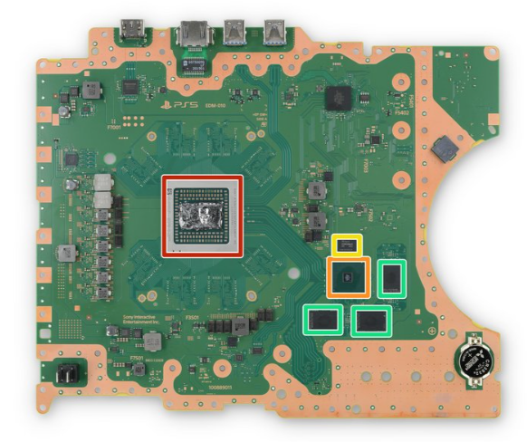

# DFD Study Log 03: PlayStation 5 (Console Teardown)

## 1. Target Device Overview
* **Device Name:** Sony PlayStation 5 (Base Model / Disc Edition)
* **Repairability Score:** 7/10 | **DFD Grade:** B (Tool-Free Outer Panels, Adhesive Fan Seals)
* **Estimated Disassembly Time & Labor Friction:** ~20–30 minutes | Low-Moderate (Tool-free outer snap panels ease entry, but deep fan/power supply access requires extensive screw removal)
* **Disassembly Goal:** Mainboard & Liquid Metal Thermal Architecture Access
* **Analysis Type:** Virtual Teardown Analysis
* **iFixit / Teardown Reference:** PS5 Mainboard & Liquid Metal Heatsink Disassembly

---

## 2. Visual Teardown Reference

*Image Source: iFixit PlayStation 5 Teardown Guide*

---

## 3. DFD Audit Checklist

### 1. Fasteners & Hardware
* [ ] **Minimum Variety:** Fail — Uses a complex mix of external security Torx (TR8/TR9), standard Phillips (#0, #1, #2), long chassis screws, and structural clips.
* [x] **Standard Drives:** Partial Pass — External white side plates are completely tool-less (slide-and-snap), but internal shield plates require specialized Security Torx drivers.
* [x] **Fastener Elimination:** Pass — High reliance on tool-less side panels for initial consumer dust-catcher cleaning.

### 2. Bonding & Materials
* [x] **Zero Permanent Glue:** Pass — Mechanical screws, structural frame interlocks, and thermal pads hold the core stack together without permanent structural adhesive.
* [x] **Thermal / Mechanical Release:** Partial Pass — Uses liquid metal (Gallium-Indium alloy) for APU thermal transfer with a specialized foam gasket barrier, making re-application during repair delicate compared to standard thermal paste.
* [x] **Material Separation:** Pass — Plastics (ABS panels), steel EMI shields, copper heat pipes, and aluminum heatsink fins cleanly separate once unscrewed.

### 3. High-Wear Component Access
* [x] **First-Layer Access:** Pass — Storage expansion (M.2 NVMe SSD slot) and dust catchers are directly accessible under the outer panel without tools or breaking warranty seals.
* [ ] **Tool-Free Removal:** Fail — Deep maintenance (power supply, optical drive, mainboard, or fan replacement) requires full disassembly with multiple screw types.

### 4. Modular Architecture
* [x] **Sub-Assemblies:** Pass — Ultra-modular design; the cooling fan, Blu-ray optical drive, power supply unit (PSU), and M.2 expansion slot exist as independent, drop-in modules.
* [x] **Cable Management:** Partial Pass — Ribbon cables connect the disc drive and power button to the motherboard, but the fan uses a standard modular 4-pin header.

---

## 4. Manufacturer Intent & Business Context
* **Why Sony Designed It This Way:** 
  1. **User Expansion vs. Internal Security:** Sony intentionally allowed tool-less access to high-wear user areas (storage expansion and dust cleaning) while using security screws on deep chassis layers to protect high-voltage components and complex liquid-metal thermal interfaces.
  2. **Thermal Dissipation Strategy:** To cool a high-power APU (over 200W) in a living room enclosure, Sony prioritized a massive custom heatsink and liquid metal thermal interface material over simplified disassembly.

---

## 5. Engineering Critique & DFD Redesign

* **Main Design Flaw:** High internal screw count with varied thread lengths and driver types (Torx + Phillips) makes reaching the mainboard slow and increases assembly/disassembly error rates during servicing.
* **DFD Redesign Recommendation:** Standardize all internal shield fasteners to a single drive head (Phillips #1), switch the fan housing to a tool-less lever-latch system, and utilize a pre-cured phase-change thermal pad instead of liquid metal to simplify automated disassembly and recycling.

## 6. Product Design & Physical Security Trade-offs
* **Tamper Resistance vs. Disassembly:** Tool-free snap-on outer panels allow easy consumer access for dust cleaning without compromising core structural security. Meanwhile, internal security Torx screws and adhesive fan seals safeguard proprietary hardware from unauthorized third-party modifications.

## 7. Regulatory & Eco-Compliance Audit
* **WEEE Target Separation:** Pass — Large modules (power supply, fan, optical drive, and mainboard) separate cleanly with standard tooling.
* **Material Identification & Sorting:** Pass — Outer covers and internal structural parts carry clear ISO plastic resin identification codes.
* **RoHS/REACH Chemical & Bonding Risk:** Pass — Minimal reliance on heavy bonding agents; components rely mostly on mechanical fasteners and snap-fits.

## 8. Material Breakdown & Polymer Selection
* **Primary Resins:** >PC+ABS< (outer white chassis plates), >PP< (internal air ducts), >PBT-GF30< (connector housings).
* **Thermal Response & Disassembly Friction:** High glass transition temperature (Tg >130°C for PC+ABS); modular snap-fit design minimizes thermal release requirements.
* **Elastomers & Waterproofing Seals:** Minimal elastomeric sealing due to passive cooling design and internal dust baffles.
* **Eco-Compliance & Circularity:** RoHS and REACH aligned, halogen-free external plastics, monochrome resin marking for automated recycling sorting.
