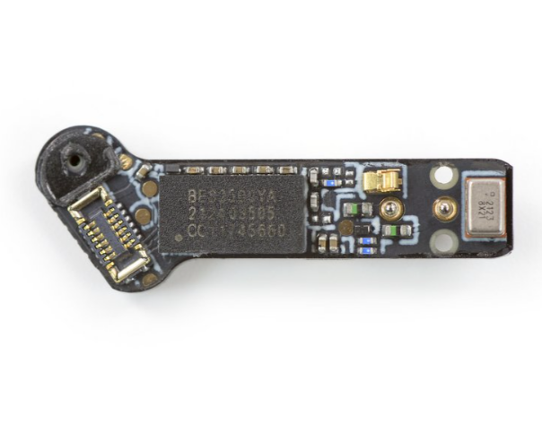

# DFD Study Log 04: Nothing Ear (1) (Wireless Earbuds & Charging Case)

## 1. Target Device Overview
* **Device Name:** Nothing Ear (1) True Wireless Earbuds
* **Repairability Score:** 0/10 | **DFD Grade:** F (Fully Glued / Non-Disassemblable Shell)
* **Disassembly Goal:** Earbud Stem PCB & Audio/Bluetooth Control Architecture Access
* **Analysis Type:** Virtual Teardown Analysis
* **iFixit / Teardown Reference:** Nothing Ear (1) Teardown & Repairability Assessment

---

## 2. Visual Teardown Reference

*Image Source: iFixit Nothing Ear (1) Teardown Guide*

---

## 3. DFD Audit Checklist

### 1. Fasteners & Hardware
* [ ] **Minimum Variety:** Fail — Uses almost zero traditional screws inside the earbuds; heavily relies on internal clips and friction fits.
* [ ] **Standard Drives:** N/A — Internal components are secured via micro-snaps rather than standard fasteners.
* [ ] **Fastener Elimination:** Partial Pass — While screws are eliminated to maintain a clean aesthetic visible through the transparent shell, it makes non-destructive disassembly nearly impossible.

### 2. Bonding & Materials
* [ ] **Zero Permanent Glue:** Fail — The transparent plastic outer shells of both the earbuds and the charging case are permanently ultrasonically welded or glued together along the seams to achieve IPX4 water resistance.
* [ ] **Thermal / Mechanical Release:** Fail — Tiny pouch batteries inside the stem and case are glued directly to internal plastic brackets and PCBs with strong adhesive pads.
* [ ] **Material Separation:** Fail — Transparent polycarbonate/acrylic shells, internal circuit boards, magnets, and copper coil antennas are heavily bonded, making clean material sorting difficult during recycling.

### 3. High-Wear Component Access
* [ ] **First-Layer Access:** Fail — Batteries and drivers are entirely sealed within glued plastic housings. Replacing a degraded battery requires prying/destroying the outer shell.
* [ ] **Tool-Free Removal:** Fail — Requires heat guns, razor blades, or prying tools to break open the bonded seams.

### 4. Modular Architecture
* [x] **Sub-Assemblies:** Partial Pass — The Bluetooth SoC, MEMS microphones, tiny lithium-ion button/pouch cell, and dynamic driver are packed sequentially inside a tight linear layout.
* [ ] **Cable Management:** Fail — Utilizes delicate micro-soldered wires and rigid-flex PCBs rather than clean, plug-in modular connectors due to extreme spatial constraints.

---

## 4. Manufacturer Intent & Business Context
* **Why Nothing Designed It This Way:** 
  1. **Aesthetic & Transparency Priority:** The core brand identity relies on a transparent design showcasing internal components, which requires seamless exterior finishes without visible screw heads or seam gaps.
  2. **Form Factor & Water Resistance:** To keep the earbuds lightweight and sweat-resistant in a tiny footprint, ultrasonic welding and strong adhesives are favored over bulky mechanical gaskets or screws.

---

## 5. Engineering Critique & DFD Redesign

* **Main Design Flaw:** Completely glued-shut enclosures and micro-soldered batteries render the device virtually unrepairable and difficult to recycle cleanly, directly conflicting with circular economy goals.
* **DFD Redesign Recommendation:** Replace ultrasonic welding on the outer shell with a snap-fit locking ring or a serviceable silicone gasket seal, use modular spring-contacts instead of soldered battery wires, and avoid permanent structural adhesives on high-wear power components.
