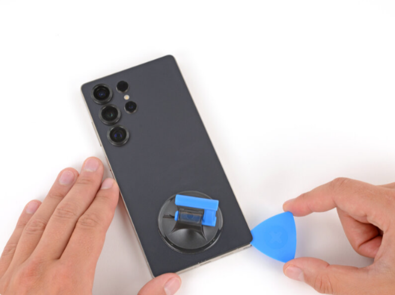

# DFD Study Log 05: Samsung Galaxy S25 Ultra (Back Cover & Chassis Access)

## 1. Target Device Overview
* **Device Name:** Samsung Galaxy S25 Ultra
* **Repairability Score:** 5/10 | **DFD Grade:** D+ (Heavy Display & Battery Bonding)
* **Estimated Disassembly Time & Labor Friction:** ~40–50 minutes | High (Heavy rear glass and battery adhesive require prolonged thermal softening and chemical solvent application)
* **Disassembly Goal:** Rear Glass Panel Removal & Internal Structural Chassis Access[cite: 5]
* **Analysis Type:** Virtual Teardown Analysis
* **iFixit / Teardown Reference:** Samsung Galaxy S25 Ultra Back Glass Removal & Internal Structural Audit[cite: 5]

---

## 2. Visual Teardown Reference

*Image Source: iFixit Samsung Galaxy S25 Ultra Teardown Guide[cite: 5]*

---

## 3. DFD Audit Checklist

### 1. Fasteners & Hardware
* [x] **Minimum Variety:** Pass — Uses standardized Phillips micro-screws across internal mid-frame brackets once inside.
* [x] **Standard Drives:** Pass — Requires no proprietary or tamper-resistant drive heads for internal shield screws.
* [ ] **Fastener Elimination:** Fail — The outer enclosure relies entirely on perimeter pressure-sensitive adhesive rather than mechanical latches or hidden screws.

### 2. Bonding & Materials
* [ ] **Zero Permanent Glue:** Fail — The rear glass panel is secured to the titanium/aluminum frame with strong perimeter adhesive gaskets to maintain IP68 dust/water resistance.
* [ ] **Thermal / Mechanical Release:** Partial Pass — Requires external thermal application (heat gun or heating pad) and suction/prying tools to soften glue without cracking the rear panel.[cite: 5]
* [x] **Material Separation:** Pass — Once detached, the back glass panel cleanly separates from the metallic chassis, allowing distinct glass and metal recycling streams.

### 3. High-Wear Component Access
* [x] **First-Layer Access:** Pass — Removing the back cover immediately exposes the wireless charging coil, NFC assembly, and battery pull-tab system.
* [ ] **Tool-Free Removal:** Fail — Requires suction cups, picks, and heating equipment to break the factory adhesive seal.[cite: 5]

### 4. Modular Architecture
* [x] **Sub-Assemblies:** Pass — Features independent sub-assemblies for camera modules, wireless charging coils, and speaker assemblies.
* [x] **Cable Management:** Pass — Uses press-fit ZIF flex connectors for the wireless coil and main board interconnections, avoiding hard-soldered jumpers.

---

## 4. Manufacturer Intent & Business Context
* **Why Samsung Designed It This Way:** 
  1. **IP68 Water Ingress Protection:** Chemical perimeter adhesive creates a hermetic seal against liquid and dust penetration, which is difficult to replicate using thin mechanical gaskets alone.
  2. **Premium Industrial Design:** Eliminates visible external fasteners on the titanium side rails to achieve a seamless, continuous aesthetic.

---

## 5. Engineering Critique & DFD Redesign

* **Main Design Flaw:** Heavy perimeter adhesive on fragile rear glass creates a high risk of cracking during entry, requiring specialized heating tools and high manual labor for initial disassembly[cite: 5].
* **DFD Redesign Recommendation:** Implement a reusable, compressed elastomeric gasket paired with perimeter flush screws or concealed corner mechanical latches. This maintains water resistance while enabling clean, tool-assisted mechanical entry without heat.

## 6. Product Design & Physical Security Trade-offs
* **Tamper Resistance vs. Disassembly:** Heavy adhesive backing and continuous frame bonding maximize drop durability and moisture sealing. This robust physical protection creates a steep barrier to entry for repairs, heavily risking component damage during ungluing.
