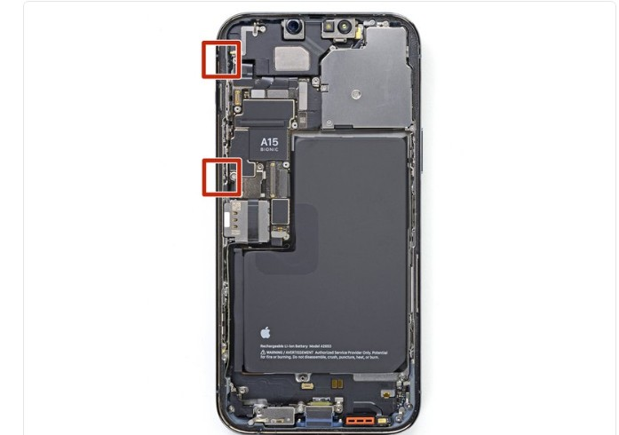

# DFD Study Log 06: iPhone 13 Pro Max (Screen & Display Assembly Removal)

## 1. Target Device Overview
* **Device Name:** iPhone 13 Pro Max
* **Disassembly Goal:** OLED Display Detachment & Internal Logic Board / Battery Access
* **Analysis Type:** Virtual Teardown Analysis
* **iFixit / Teardown Reference:** iPhone 13 Pro Max Screen Replacement & Structural Audit

---

## 2. Visual Teardown Reference

*Image Source: iFixit iPhone 13 Pro Max Teardown Guide*

---

## 3. DFD Audit Checklist

### 1. Fasteners & Hardware
* [ ] **Minimum Variety:** Fail — Uses multiple non-standard driver types, including external Pentalobe screws and internal Tri-Point (Y000) fasteners securing shield plates.
* [ ] **Standard Drives:** Fail — Demands specialized driver bits (Pentalobe, Tri-Point, Standoff drivers) rather than standard Phillips or Torx.
* [x] **Fastener Elimination:** Pass — Relies on physical bottom screws combined with perimeter retention clips for display securing rather than glue-only housing attachment.

### 2. Bonding & Materials
* [ ] **Zero Permanent Glue:** Fail — Utilizes heavy perimeter pressure-sensitive adhesive (PSA) foam tape around the frame to maintain IP68 water resistance.
* [ ] **Thermal / Mechanical Release:** Partial Pass — Requires external thermal application, suction tools, and prying picks to soften the watertight adhesive seal without damaging delicate flex ribbon cables.
* [x] **Material Separation:** Pass — Once detached, the front glass/OLED panel cleanly separates from the stainless steel chassis, enabling distinct glass and metal recycling streams.

### 3. High-Wear Component Access
* [x] **First-Layer Access:** Pass — The display assembly serves as the main entry point; removing the screen provides immediate access to the internal L-shaped battery and logic board connectors.
* [ ] **Tool-Free Removal:** Fail — Demands specialized opening tools, suction handles, and heating pads for initial separation.

### 4. Modular Architecture
* [x] **Sub-Assemblies:** Pass — Display digitizer, ear speaker flex, and sensor arrays function as discrete modules connected via press-fit ZIF flex connectors.
* [ ] **Cable Management:** Partial Pass — Displays short flex ribbon cables anchored to the side of the logic board, presenting a high risk of tearing if opened beyond a 90-degree angle.

---

## 4. Manufacturer Intent & Business Context
* **Why Apple Designed It This Way:** 
  1. **Structural & Environmental Resilience:** Perimeter foam tape and stainless steel frame clips provide robust IP68 ingress protection against liquids and dust.
  2. **Anti-Tamper & Authorization Control:** Proprietary screw heads discourage third-party repairs and enforce authorized service center workflows.

---

## 5. Engineering Critique & DFD Redesign

* **Main Design Flaw:** High reliance on proprietary fasteners and perimeter adhesive makes display entry difficult for non-specialists, increasing the risk of severing micro-flex cables upon opening.
* **DFD Redesign Recommendation:** Transition from perimeter adhesive tape to a re-usable elastomeric compression gasket sealed with standard Torx screws, allowing clean mechanical entry and simplified re-assembly.
