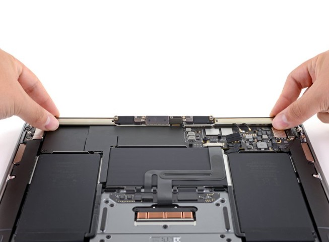

# DFD Study Log 07: MacBook Air 13" Late 2020 (Screen & Display Assembly Replacement)

## 1. Target Device Overview
* **Device Name:** MacBook Air 13" (Late 2020, M1)
* **Repairability Score:** 6/10 | **DFD Grade:** C+ (Modular Hinges, Multi-Drive Hardware Overhead)
* **Disassembly Goal:** Complete Display Assembly (LID) Detachment & Hinge Access
* **Analysis Type:** Virtual Teardown Analysis
* **iFixit / Teardown Reference:** MacBook Air 13" Late 2020 Display Assembly Replacement & Structural Audit

---

## 2. Visual Teardown Reference

*Image Source: iFixit MacBook Air 13" Late 2020 Teardown Guide*

---

## 3. DFD Audit Checklist

### 1. Fasteners & Hardware
* [ ] **Minimum Variety:** Fail — Uses a mix of proprietary external Pentalobe (P5) screws, internal Torx (T3, T5, T8), and specialized standoff fasteners across mid-frame brackets.
* [ ] **Standard Drives:** Fail — Demands specialized driver bits (Pentalobe and multiple micro-Torx sizes) rather than standard Phillips or uniform hardware.
* [x] **Fastener Elimination:** Pass — Relies entirely on mechanical threaded fasteners for enclosure securing rather than glue-sealed clamshell housings.

### 2. Bonding & Materials
* [x] **Zero Permanent Glue:** Pass — The display hinges, top case, bottom cover, and display cables are held purely by screws, metal brackets, and mechanical alignment pins.
* [x] **Thermal / Mechanical Release:** Pass — Requires zero heat or solvent application to detach the entire display assembly from the main chassis once internal brackets are unscrewed.
* [x] **Material Separation:** Pass — Clean mechanical separation between the aluminum chassis, logic board, and glass/display assembly allows highly efficient material sorting.

### 3. High-Wear Component Access
* [ ] **First-Layer Access:** Fail — Replacing the display assembly requires removing the bottom cover, disconnecting the battery flex cable, removing the antenna board cover, and unthreading hinge brackets.
* [ ] **Tool-Free Removal:** Fail — Requires precise driver bits (P5, T3, T5, T8) and ESD-safe spudgers for delicate connector disconnection.

### 4. Modular Architecture
* [x] **Sub-Assemblies:** Pass — The display assembly functions as a self-contained unit (panel, lid, hinges, and integrated webcam/sensor cable).
* [ ] **Cable Management:** Partial Pass — Embedded flex cables routed through tight hinge channels present a high risk of snagging or tearing during display alignment.

---

## 4. Manufacturer Intent & Business Context
* **Why Apple Designed It This Way:** 
  1. **Ultra-Thin Form Factor:** Direct screw-and-hinge anchoring into the CNC-machined aluminum unibody maximizes rigidity while minimizing vertical thickness.
  2. **Service Control & Component Pairing:** Modular display connection via delicate micro-coaxial connectors ensures authorized calibration and anti-tamper controls.

---

## 5. Engineering Critique & DFD Redesign

* **Main Design Flaw:** Accessing the display hinges requires prior removal of the battery interface shield, antenna board, and multiple micro-Torx brackets, significantly increasing teardown steps for a high-turnover repair.
* **DFD Redesign Recommendation:** Consolidate hinge screws to a single standardized Torx drive size and utilize top-accessible external hinge caps or quick-release latching pins to allow screen swapping without deep internal board disassembly.

## 6. Product Design & Physical Security Trade-offs
* **Tamper Resistance vs. Disassembly:** Direct unibody screw anchoring provides solid structural rigidity and prevents casual casing separation. While internal components are mechanically secured rather than glued, the mix of proprietary drive bits deters unauthorized internal tampering.
