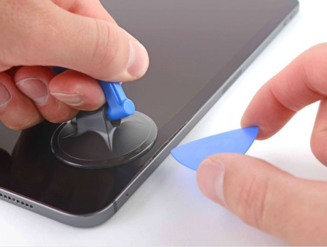

# DFD Study Log 08: iPad Pro 11" 4th Gen (Screen & Display Assembly Replacement)

## 1. Target Device Overview
* **Device Name:** iPad Pro 11" 4th Generation (M2)
* **Repairability Score:** 3/10 | **DFD Grade:** D (High Glass Fracture Risk & Perimeter Bonding)
* **Estimated Disassembly Time & Labor Friction:** ~50–60 minutes | High (Extreme glass fracture risk, heavy perimeter adhesive, and delicate Face ID flex cable positioning)
* **Disassembly Goal:** Liquid Retina Display Separation & Internal Connector Uncoupling
* **Analysis Type:** Virtual Teardown Analysis
* **iFixit / Teardown Reference:** iPad Pro 11" 4th Gen Display Replacement & Structural Audit

---

## 2. Visual Teardown Reference

*Image Source: iFixit iPad Pro 11" 4th Gen Teardown Guide*

---

## 3. DFD Audit Checklist

### 1. Fasteners & Hardware
* [x] **Minimum Variety:** Pass — Uses uniform internal Phillips/Torx screws for shield plates and bracket retention once inside.
* [x] **Standard Drives:** Pass — Internal fasteners rely on standard Phillips/Torx drivers rather than multi-pin proprietary bits.
* [ ] **Fastener Elimination:** Fail — Relies heavily on full-perimeter adhesive tape rather than mechanical latches or frame screws to hold the display panel to the aluminum chassis.

### 2. Bonding & Materials
* [ ] **Zero Permanent Glue:** Fail — Bound by strong, continuous perimeter acrylic/PSA adhesive around the edge of the glass display.
* [ ] **Thermal / Mechanical Release:** Partial Pass — Requires external heating tools, suction cups, and thin prying picks to slice through the adhesive perimeter without cracking the glass.
* [x] **Material Separation:** Pass — Clean mechanical detachment once heated, completely isolating the glass/OLED fused digitizer panel from the aluminum unibody.

### 3. High-Wear Component Access
* [x] **First-Layer Access:** Pass — The glass display panel is the primary outer barrier; separating it gives immediate access to internal battery, logic board, and secondary flex assemblies.
* [ ] **Tool-Free Removal:** Fail — Demands specialized heating pads, suction handles, opening picks, and precision driver bits.

### 4. Modular Architecture
* [x] **Sub-Assemblies:** Pass — Fused display panel connects via modular flex cables secured beneath metal protective brackets.
* [ ] **Cable Management:** Partial Pass — Short display flex ribbons near the logic board create a high risk of tearing if the display is opened beyond a narrow angle before disconnecting.

---

## 4. Manufacturer Intent & Business Context
* **Why Apple Designed It This Way:** 
  1. **Ultra-Thin Seamless Design:** Eliminating bezel screws allows a flush glass-to-aluminum edge-to-edge profile.
  2. **Structural Integrity:** Perimeter adhesive distributes mechanical strain evenly across the screen surface, preventing localized flex under touch input.

---

## 5. Engineering Critique & DFD Redesign

* **Main Design Flaw:** Heavy perimeter adhesive bonding requires extensive heating and delicate slicing, making screen replacement high-risk for cracking display glass or severing sensor flex cables.
* **DFD Redesign Recommendation:** Introduce hidden stretch-release adhesive pull tabs or an internal perimeter latch system with standard accessible screws along the frame edges, allowing safe mechanical detachment without heat.

## 6. Product Design & Physical Security Trade-offs
* **Tamper Resistance vs. Disassembly:** Continuous display-edge adhesive ensures a rigid, ultra-slim profile with robust protection against physical twisting and environmental elements. The heavy reliance on glue acts as a strong tamper deterrent, making safe non-destructive entry difficult.

## 7. Regulatory & Eco-Compliance Audit
* **WEEE Target Separation:** Partial Pass — Display glass and battery extraction carry high fracture and puncture risks due to heavy adhesive bonding.
* **Material Identification & Sorting:** Pass — Metal housing and glass elements sort well once completely unbonded.
* **RoHS/REACH Chemical & Bonding Risk:** Warning — Extensive perimeter display adhesive and optical clear resins introduce high bonding contamination risks.
