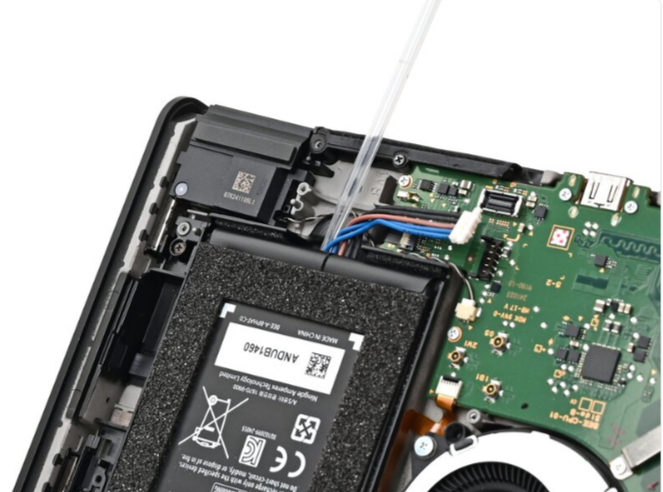

# DFD Study Log 09: Nintendo Switch 2 (Internal Battery Replacement)

## 1. Target Device Overview
* **Device Name:** Nintendo Switch 2
* **Repairability Score:** 5/10 | **DFD Grade:** D+ (Adhesive-Secured Cell & Multi-Drive Fastener Matrix)
* **Disassembly Goal:** Back-Cover Detachment, Shield Plate Removal, & Adhered Battery Cell Extraction
* **Analysis Type:** Virtual Teardown Analysis
* **iFixit / Teardown Reference:** Nintendo Switch 2 Battery Replacement & Structural Audit

---

## 2. Visual Teardown Reference

*Image Source: iFixit Nintendo Switch 2 Teardown Guide*

---

## 3. DFD Audit Checklist

### 1. Fasteners & Hardware
* [ ] **Minimum Variety:** Fail — Utilizes a complicated mix of driver requirements including JIS 00, tri-point Y00, and exterior security screws across the housing and kickstand assembly.
* [ ] **Standard Drives:** Fail — Demands specialized precision bits (JIS and Tri-Point) instead of standard uniform hardware.
* [x] **Fastener Elimination:** Pass — Relies on threaded screw anchors around the perimeter and kickstand well rather than plastic snap welds for the main rear housing.

### 2. Bonding & Materials
* [ ] **Zero Permanent Glue:** Fail — The internal lithium-ion battery cell is locked down tightly using industrial pressure-sensitive adhesive (PSA) strips requiring chemical softeners.
* [ ] **Thermal / Mechanical Release:** Partial Pass — Requires safe application of high-concentration isopropyl alcohol or thermal softening techniques to release the battery safely without bending or puncturing.
* [x] **Material Separation:** Pass — Clear delineation between plastic outer housing elements, internal metal EMI shield plates, and electronic subassemblies for component recycling.

### 3. High-Wear Component Access
* [ ] **First-Layer Access:** Fail — Reaching the battery requires removing external decorative side stickers, taking off the rear panel, unfastening interior metallic shield plates, and disconnecting surface-mounted ribbon cables.
* [ ] **Tool-Free Removal:** Fail — Requires specialized driver kits, opening picks, tweezers, and chemical solvent applicators.

### 4. Modular Architecture
* [x] **Sub-Assemblies:** Pass — Battery features a plug-and-socket connector interface to the mainboard rather than direct solder tabs.
* [ ] **Cable Management:** Partial Pass — Internal thermal pads/putty and closely routed interconnect cables complicate the clearance path over the battery bay.

---

## 4. Manufacturer Intent & Business Context
* **Why Nintendo Designed It This Way:** 
  1. **Structural Rigidity & Drop Protection:** Securing the internal battery block with full-surface adhesive absorbs shock energy during accidental drops.
  2. **Tamper Mitigation & Slim Form Factor:** Minimizing empty interior dead-space allows maximum battery capacity within a portable handheld chassis while deterring unverified consumer repairs.

---

## 5. Engineering Critique & DFD Redesign

* **Main Design Flaw:** Heavy reliance on sticky structural battery adhesive and multi-drive screw matrices makes routine power-cell swaps tedious and risky for average users.
* **DFD Redesign Recommendation:** Implement stretch-release pull tabs (similar to modern smartphone designs) alongside a uniform single-drive screw head standard to enable fast, tool-light battery replacement.
