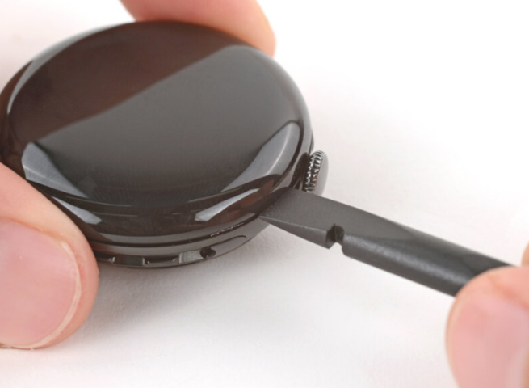

# DFD Study Log 10: Google Pixel Watch 4 (Screen & Display Assembly Replacement)

## 1. Target Device Overview
* **Device Name:** Google Pixel Watch 4
* **Repairability Score:** 4/10 | **DFD Grade:** D (High Adhesive Density & Compact Curvature Risk)
* **Estimated Disassembly Time & Labor Friction:** ~40–50 minutes | High (Curved 3D AMOLED display bonded with high-density structural perimeter glue, risking glass fracture)
* **Disassembly Goal:** Curved AMOLED Display Separation & Internal Ribbon Disconnection
* **Analysis Type:** Virtual Teardown Analysis
* **iFixit / Teardown Reference:** Google Pixel Watch 4 Display Replacement & Structural Audit

---

## 2. Visual Teardown Reference

*Image Source: iFixit Google Pixel Watch 4 Teardown Guide*

---

## 3. DFD Audit Checklist

### 1. Fasteners & Hardware
* [x] **Minimum Variety:** Pass — Uses uniform micro-Torx fasteners internally once the outer display assembly is unbonded.
* [x] **Standard Drives:** Pass — Internal brackets rely on standard precision micro-Torx bits rather than multi-pin proprietary security screws.
* [ ] **Fastener Elimination:** Fail — Structural retention of the outer glass dome relies entirely on perimeter liquid adhesive rather than mechanical latches or bezel screws.

### 2. Bonding & Materials
* [ ] **Zero Permanent Glue:** Fail — Sealed with heavy perimeter structural adhesive along the curved glass rim to maintain water resistance.
* [ ] **Thermal / Mechanical Release:** Partial Pass — Requires precise localized heat application and suction tools to detach the curved glass without fracturing the OLED substrate.
* [x] **Material Separation:** Pass — Clean mechanical isolation of the display glass assembly from the recycled aluminum chassis once adhesive bonds are severed.

### 3. High-Wear Component Access
* [x] **First-Layer Access:** Pass — Lifting the screen panel provides direct top-down access to the internal mainboard, battery assembly, and haptic engine.
* [ ] **Tool-Free Removal:** Fail — Requires heat guns/pads, suction clamps, ultra-thin prying shims, and precision driver sets.

### 4. Modular Architecture
* [x] **Sub-Assemblies:** Pass — Fused display module connects to the main system board via a single press-fit ZIF/board-to-board flex connector.
* [ ] **Cable Management:** Partial Pass — Ultra-short flex cables require cautious prying to avoid tearing the ribbon cable during screen lifting.

---

## 4. Manufacturer Intent & Business Context
* **Why Google Designed It This Way:** 
  1. **Continuous 3D Glass Aesthetics & Ergonomics:** Eliminating visible bezel fasteners allows a seamless, curved dome interface.
  2. **High Ingress Protection (IP Rating):** Continuous perimeter bonding guarantees tight water and dust sealing required for swim-proof wearable tracking.

---

## 5. Engineering Critique & DFD Redesign

* **Main Design Flaw:** The curved glass perimeter makes mechanical prying high-risk, as force applied to the 3D edge can easily fracture the glass or damage the underlying touch sensors.
* **DFD Redesign Recommendation:** Implement a twist-lock or gasket-sealed mechanical retaining ring mechanism to preserve water resistance while allowing non-thermal, tool-light screen separation.

---

## 6. Product Design & Physical Security Trade-offs
* **Tamper Resistance vs. Disassembly:** The continuous structural adhesive perimeter provides high IP-rated ingress protection and prevents physical tampering with internal sensor data. However, this tight environmental sealing creates high friction for display repairs, requiring heat and delicate mechanical separation.
