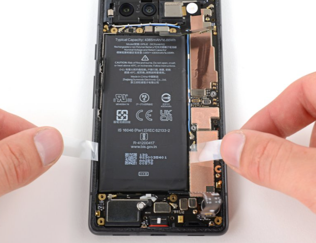

# DFD Study Log 11: Google Pixel 7a (Internal Battery Replacement)

## 1. Target Device Overview
* **Device Name:** Google Pixel 7a
* **Repairability Score:** 5/10 | **DFD Grade:** D+ (Heavy Battery Adhesive & Plastic Back Cover Separation)
* **Estimated Disassembly Time & Labor Friction:** ~35–45 minutes | Moderate-High (Heat application required for plastic back panel removal; strong battery adhesive pull tabs prone to snapping)
* **Disassembly Goal:** Rear Plastic Panel Removal, Midframe Unfastening, & Battery Extraction
* **Analysis Type:** Virtual Teardown Analysis
* **iFixit / Teardown Reference:** Google Pixel 7a Battery Replacement & Structural Audit

---

## 2. Visual Teardown Reference

*Image Source: iFixit Google Pixel 7a Teardown Guide*[cite: 4]

---

## 3. DFD Audit Checklist

### 1. Fasteners & Hardware
* [x] **Minimum Variety:** Pass — Uses standard T3 Torx screws throughout the internal midframe and protective shield plates.
* [x] **Standard Drives:** Pass — Leverages standard Torx drive heads rather than non-standard or proprietary multi-pin security screws.
* [ ] **Fastener Elimination:** Fail — Relies on perimeter adhesive to hold the thermoformed plastic rear panel in place instead of mechanical clips or latches.

### 2. Bonding & Materials
* [ ] **Zero Permanent Glue:** Fail — The battery cell is heavily secured to the inner frame using dense pressure-sensitive adhesive (PSA).
* [ ] **Thermal / Mechanical Release:** Partial Pass — Includes pull tabs, but high failure rates often require isopropyl alcohol (IPA) assistance to safely soften the adhesive bond.
* [x] **Material Separation:** Pass — Clear material separation between the thermoformed plastic rear cover, aluminum internal frame, and circuit assemblies once fasteners and glue are removed.

### 3. High-Wear Component Access
* [ ] **First-Layer Access:** Fail — Accessing the battery requires removing the rear panel, removing numerous midframe Torx screws, disconnecting the battery flex cable bracket, and unseating the wireless charging coil assembly.
* [ ] **Tool-Free Removal:** Fail — Requires heat pads/guns, opening picks, suction tools, T3 Torx drivers, and adhesive solvents.

### 4. Modular Architecture
* [x] **Sub-Assemblies:** Pass — The battery features a detachable board-to-board press connector rather than soldered leads.
* [ ] **Cable Management:** Partial Pass — Screen flex cable routes across the battery well under protective tape, requiring careful handling during cell removal.

---

## 4. Manufacturer Intent & Business Context
* **Why Google Designed It This Way:** 
  1. **Cost-Effective IP67 Water/Dust Resistance:** Continuous perimeter adhesive allows tight sealing on a mid-range budget device without requiring expensive mechanical gaskets.
  2. **Structural Integrity & Budget Materials:** Using a thermoformed plastic back panel backed by structural adhesive maintains rigidity while keeping manufacturing costs lower than premium glass/aluminum flagship builds.

---

## 5. Engineering Critique & DFD Redesign

* **Main Design Flaw:** The stretch-release pull tabs under the battery frequently tear during manual pull attempts, forcing technicians to resort to prying or chemical solvents near a high-density cell.
* **DFD Redesign Recommendation:** Implement full-width stretch-release adhesive pull tabs (similar to modern iPhone designs) or a reusable mechanical metal bracket enclosure for easy, solvent-free battery removal.

---

## 6. Product Design & Physical Security Trade-offs
* **Tamper Resistance vs. Disassembly:** The perimeter adhesive seal and hidden midframe fasteners protect internal components from dust/water intrusion and casual physical tampering. However, this configuration increases repair friction by requiring thermal softening and multi-step internal disassembly to swap consumable battery components.

---

## 7. Regulatory & Eco-Compliance Audit
* **WEEE Target Separation:** Partial Pass — The battery and logic board can be isolated, but strong internal adhesives and delicate ribbon cabling increase the risk of component damage during rapid extraction.
* **Material Identification & Sorting:** Pass — Plastic back panel and internal composite elements carry clear resin/material stamps for post-consumer sorting.
* **RoHS/REACH Chemical & Bonding Risk:** Warning — Structural battery PSA tapes and perimeter sealing glues act as contaminants in automated mechanical shredding and sorting streams.

## 8. Material Breakdown & Polymer Selection
* **Primary Resins:** >PC-GF< (thermoformed back panel), >PA66< internal support frames.
* **Thermal Response & Disassembly Friction:** Moderate glass transition temperature (Tg ~90°C); back cover adhesive softens cleanly at 75–80°C via heat pad.
* **Elastomers & Waterproofing Seals:** Silicone perimeter gasket for IP67 water and dust resistance.
* **Eco-Compliance & Circularity:** RoHS and REACH compliant, significant post-consumer recycled plastic content in back cover and midframe components.
